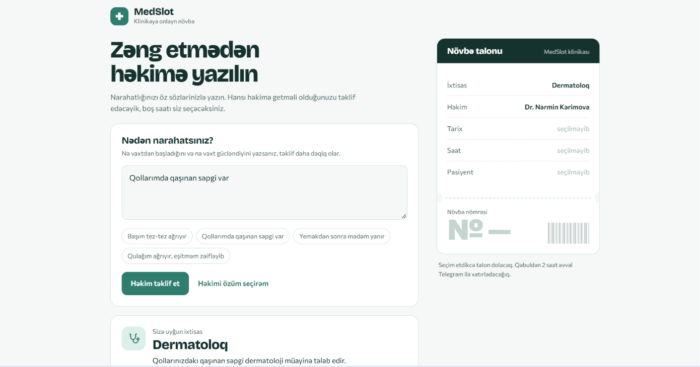
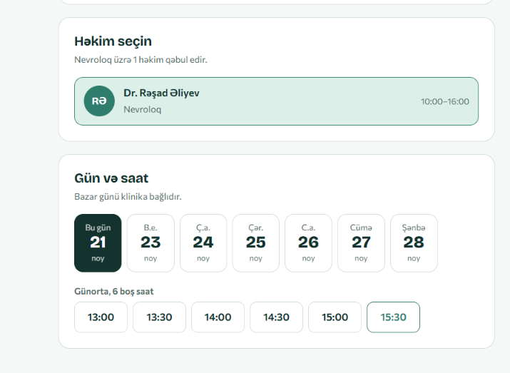
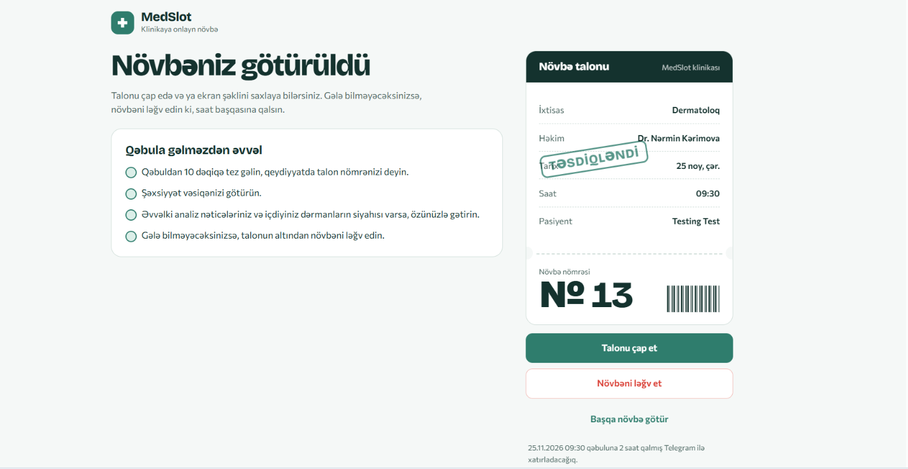
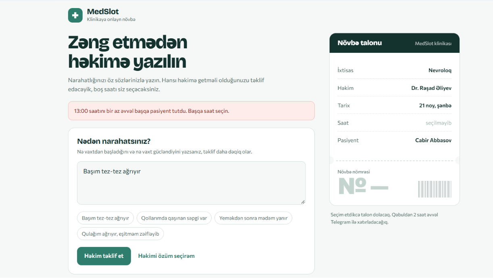
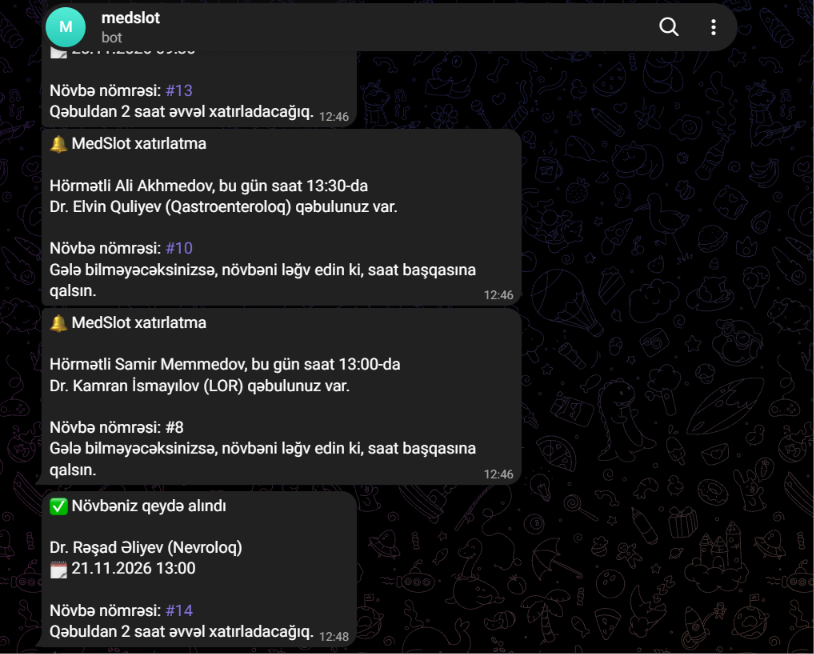

# MedSlot

Klinikalar üçün onlayn növbə sistemi. Pasiyent şikayətini öz sözləri ilə yazır, AI uyğun ixtisası təklif edir, pasiyent boş saatı seçib növbə götürür. Təsdiq, ləğv və qəbuldan əvvəlki xatırlatma Telegram ilə gəlir.

## Hansı problemi həll edir

Bir çox klinikada növbələr hələ də telefonla yazılır. Bunun nəticəsində:

- eyni saata iki pasiyent yazılır;
- pasiyent hansı həkimə getməli olduğunu bilmir;
- növbəni unudan pasiyent gəlmir və saat boş qalır.

MedSlot bu üç problemi aradan qaldırır.

## İmkanlar

- **AI yönləndirmə.** Groq API şikayəti oxuyur və klinikadakı ixtisaslardan birini təklif edir. Şikayətdə təcili hal əlaməti varsa, pasiyent 103-ə zəng etməyə yönləndirilir.
- **Eyni saata iki yazılış mümkün deyil.** Slot atomik `UPDATE ... WHERE status = 'free'` ilə tutulur. Bazadakı qismən unikal indeks ikinci aktiv yazılışın qarşısını ayrıca alır.
- **Avtomatik slotlar.** Python skripti hər həkimin iş saatlarından növbəti 7 gün üçün 30 dəqiqəlik saatlar yaradır. Mövcud saatlar təkrar yaradılmır.
- **Telegram bildirişləri.** Növbə təsdiqlənəndə və ləğv olunanda mesaj gəlir. Qəbula 2 saat qalmış isə bir dəfə xatırlatma göndərilir.
- **Növbə talonu.** Pasiyent seçim etdikcə talon dolur. Təsdiqdən sonra talonu çap etmək olur.
- **Doluluq hesabatı.** Hər həkim üzrə slot sayı, dolu saatlar və ləğv edilmiş növbələr.

## Texnologiyalar

| Hissə | Texnologiya |
|---|---|
| Backend və avtomatlaşdırma | n8n (Webhook, Postgres, HTTP Request, IF, Code, Schedule, Telegram) |
| Verilənlər bazası | PostgreSQL 17 |
| Skriptlər | Python 3.11+, SQLAlchemy, psycopg2, requests |
| AI | Groq API (`openai/gpt-oss-120b`) |
| Frontend | HTML, CSS, JavaScript |
| Mühit | Docker Compose |
| API testləri | Postman |

## Arxitektura

```
 Frontend (index.html)
     │  HTTP / JSON
     ▼
 n8n ──────────────► Groq API   (şikayət → ixtisas)
  W1 Növbə API ─────► Telegram  (təsdiq / ləğv)
  W2 AI yönləndirmə
  W3 Xatırlatma ────► Telegram  (qəbuldan 2 saat əvvəl)
     │  SQL
     ▼
 PostgreSQL ◄──── Python: seed.py, slot_generator.py, report.py
```

n8n və Python skriptləri bir-birini birbaşa çağırmır. Python slotları bazaya yazır, n8n onları bazadan oxuyur.

## Verilənlər bazası

| Cədvəl | Sütunlar | Qeyd |
|---|---|---|
| `doctors` | id, full_name, specialty, work_start, work_end | |
| `slots` | id, doctor_id, start_at, status | `free` / `booked`; `(doctor_id, start_at)` unikaldır |
| `patients` | id, full_name, phone, chat_id | telefon unikaldır |
| `appointments` | id, slot_id, patient_id, complaint, status, reminded, created_at | `booked` / `cancelled`; bir slotda yalnız bir aktiv yazılış |

## API

Baza ünvan: `http://localhost:5678/webhook/medslot`

| Metod | Yol | Sorğu | Cavab |
|---|---|---|---|
| GET | `/doctors` | | `{ doctors: [...] }` |
| GET | `/slots` | `?doctor_id=1&date=2026-11-23` | `{ slots: [{ id, date, time }] }`, 400 |
| POST | `/triage` | `{ complaint }` | `{ specialty, reason, urgent, doctors }`, 400 |
| POST | `/book` | `{ slot_id, full_name, phone, complaint }` | `{ appointment }`, 400, **409** (saat tutulub) |
| POST | `/cancel` | `{ appointment_id }` | `{ ok, freed }`, 404 |

Bütün sorğular `postman/MedSlot.postman_collection.json` kolleksiyasındadır.

## Quraşdırma

**Tələblər:** Docker Desktop, Python 3.11+, [Groq API açarı](https://console.groq.com), [@BotFather](https://t.me/BotFather)-dan Telegram bot token-i.

**1. Konteynerləri işə sal**

```bash
docker compose up -d
```

n8n `http://localhost:5678` ünvanında açılır.

**2. Bazanı və slotları hazırla**

```bash
cd python
python -m venv .venv
.venv\Scripts\activate          # Mac/Linux: source .venv/bin/activate
pip install -r requirements.txt
python seed.py                  # cədvəllər və həkimlər
python slot_generator.py --once # növbəti 7 günün slotları
```

`python slot_generator.py` arqumentsiz işə salınsa, hər saat slotları yeniləyən fon prosesi kimi işləyir.

**3. n8n-i qur**

1. Bu adlarla 3 credential yarat:
   - **MedSlot DB** (Postgres): host `postgres`, port `5432`, database `layihe`, user `app`, password `app123`
   - **Groq API** (Header Auth): name `Authorization`, value `Bearer <GROQ_API_KEY>`
   - **MedSlot Bot** (Telegram API): bot token
2. `n8n/` qovluğundakı 3 workflow-u import et: **⋯ → Import from File**.
3. W1 və W3-dəki Telegram node-larında chat_id-ni öz chat_id-nlə əvəz et.
4. Hər workflow-u aktiv et.

Node-ların ətraflı izahı: [`n8n/WORKFLOWS.md`](n8n/WORKFLOWS.md).

**4. Frontend-i aç**

```bash
cd frontend
python -m http.server 5500
```

Brauzerdə `http://localhost:5500` ünvanını aç.

**5. Yoxla**

```bash
cd python
python demo_double_book.py   # eyni saata iki yazılış: 200 və 409
python report.py             # həkimlər üzrə doluluq hesabatı
```

> Baza şifrəsi (`app` / `app123`) yalnız lokal demo üçündür. Real açarlar kodda deyil, n8n credential-larında və `.env` faylında saxlanılır. Nümunə üçün `.env.example` faylına bax.

## Qovluq quruluşu

```
├─ docker-compose.yml           n8n və PostgreSQL
├─ .env.example                 lazım olan açarların nümunəsi
├─ python/
│  ├─ db.py                     bağlantı ayarları
│  ├─ models.py                 SQLAlchemy modelləri
│  ├─ seed.py                   cədvəllər və həkimlər
│  ├─ slot_generator.py         7 günlük slotlar
│  ├─ report.py                 doluluq hesabatı (psycopg2)
│  └─ demo_double_book.py       ikiqat yazılış testi
├─ n8n/
│  ├─ W1_novbe_api.json         növbə API
│  ├─ W2_ai_yonlendirme.json    AI yönləndirmə
│  ├─ W3_xatirlatma.json        Telegram xatırlatma
│  ├─ WORKFLOWS.md              node-ların izahı
│  └─ sql/                      workflow-lardakı SQL sorğuları
├─ postman/                     API kolleksiyası
├─ frontend/index.html          pasiyent səhifəsi
└─ docs/screenshots/            ekran şəkilləri
```

## Ekran şəkilləri

| Şikayət və AI təklifi | Gün və saat seçimi | Təsdiq olunmuş talon |
|---|---|---|
|  |  |  |

| Saat artıq tutulub | Telegram bildirişi |
|---|---|
|  |  |

## Gələcək planlar

- Gözləmə siyahısı: ləğv edilən saat ilk gözləyən pasiyentə Telegram ilə təklif olunur.
- Klinika administratoru üçün günün cədvəli və doluluq paneli.
- Gəlməyən pasiyentlərin (`no_show`) qeydiyyatı və statistikası.
- Serverə yerləşdirmə (deploy).